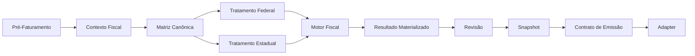
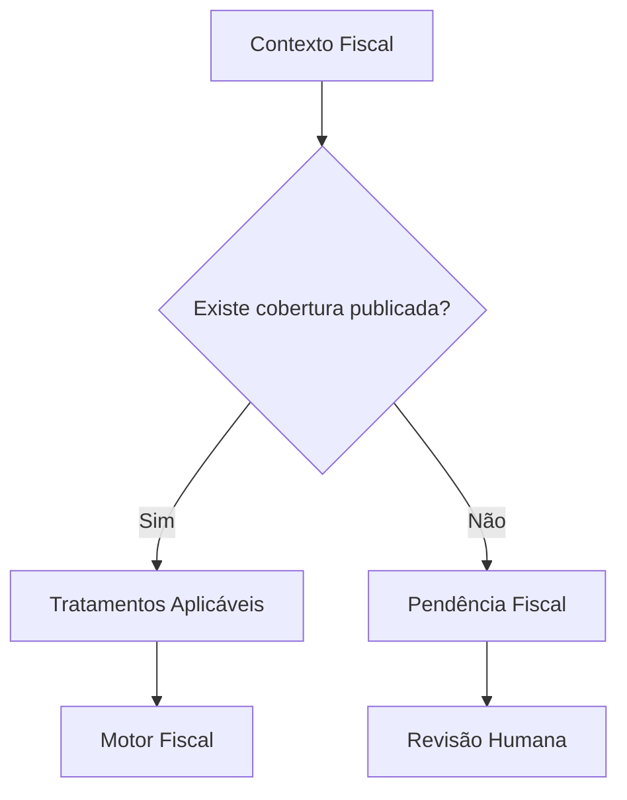
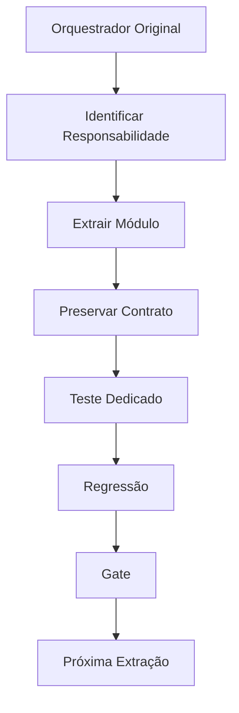

# Architecture Overview

Este documento apresenta uma visão de alto nível da arquitetura da plataforma.

O objetivo é demonstrar organização de domínio, separação de responsabilidades e evolução arquitetural sem expor código-fonte proprietário, dados empresariais ou regras fiscais confidenciais.

---

## 1. Visão arquitetural

A plataforma nasceu no domínio operacional de expedição e conferência industrial e evoluiu progressivamente para integrar preparação de faturamento e domínio fiscal.


A arquitetura atual pode ser classificada como um **monólito modular**, com separação interna progressiva dos principais domínios.

O objetivo da evolução arquitetural não é criar microserviços artificialmente, mas estabelecer fronteiras claras entre responsabilidades.

---

## 2. Domínio operacional

A camada operacional trata o fluxo físico e informacional relacionado à expedição.

Visão simplificada:


A integração completa entre **Pedido → Planejamento → Mapa** ainda está em evolução.

Por isso, esse fluxo representa a direção arquitetural da plataforma e não significa que todas as etapas estejam igualmente automatizadas no ambiente atual.

A camada de conferência, por outro lado, possui utilização operacional real.

---

## 3. Conferência híbrida

O ambiente industrial possui situações nas quais nem todos os itens podem ser identificados ou processados automaticamente.

Por isso, a arquitetura não exige automação total para funcionar.

```mermaid
flowchart TD

    A[Itens da Expedição]
    A --> B{Forma de Conferência}

    B -->|Automática| C[QR Code / Identificação]
    B -->|Manual| D[Conferência pelo Operador]

    C --> E[Resultado Consolidado]
    D --> E

    E --> F[Mapa Digital]
```



Isso permite introduzir automação progressivamente sem interromper operações que ainda dependem de intervenção humana.

---

## 4. Transição entre operação e fiscal

A separação entre operação física e decisão fiscal é uma característica importante da arquitetura.


A conferência determina **o que efetivamente está seguindo no fluxo operacional**.

O domínio fiscal utiliza informações estruturadas desse processo juntamente com contexto comercial, cadastral e tributário para preparar a decisão fiscal.

---

## 5. Pipeline fiscal

A camada fiscal foi estruturada para separar contexto, autoridade fiscal, determinação, materialização e emissão.



Essa estrutura busca impedir que decisões tributárias fiquem distribuídas de maneira não governada entre telas, rotas e integrações.

---

## 6. Contexto fiscal canônico

A determinação fiscal considera um conjunto estruturado de dimensões.

Entre elas:

| Dimensão | Função |
|---|---|
| Emitente | Identifica o contexto da empresa emissora |
| Operação | Define a natureza da operação |
| Regime do emitente | Contextualiza o tratamento tributário |
| Tipo de cliente | Classificação fiscal/comercial do destinatário |
| Contribuinte ICMS | Situação tributária do destinatário |
| Consumidor final | Contexto da destinação |
| UF origem | Estado de origem |
| UF destino | Estado de destino |
| NCM | Classificação fiscal da mercadoria |
| CEST | Contexto relacionado à substituição tributária quando aplicável |
| Origem da mercadoria | Origem fiscal do item |
| Finalidade | Finalidade do documento/operação |

A combinação dessas dimensões permite procurar cobertura fiscal para determinado cenário.

---

## 7. Matriz Canônica

A Matriz Canônica funciona como uma camada de decisão governada entre o contexto da operação e os tratamentos tributários.



Um princípio importante é:

> Ausência de cobertura não deve ser transformada silenciosamente em uma regra fiscal presumida.

Quando o sistema não encontra autoridade suficiente para determinar o tratamento, a situação deve ser tratada como pendência.

---

## 8. Governança

As decisões fiscais podem possuir ciclo de vida controlado.


Apenas regras adequadamente governadas devem assumir autoridade operacional.

Esse modelo busca manter o profissional responsável pelo domínio fiscal como autoridade sobre as decisões, enquanto o software executa de maneira reproduzível as regras aprovadas.

---

## 9. Materialização e Snapshot

Uma decisão fiscal não deve depender indefinidamente do estado atual dos cadastros.

Após determinação e revisão, o resultado pode ser materializado e preservado.


O snapshot permite preservar o contexto fiscal aprovado para determinada operação mesmo que regras ou cadastros sejam alterados posteriormente.

---

## 10. Fronteira de emissão

A arquitetura busca evitar dependência direta entre o motor fiscal e um provedor específico de emissão.


Essa fronteira permite separar:

**determinação fiscal**

de

**integração com infraestrutura externa de emissão**.

A homologação externa completa permanece uma etapa distinta da validação interna da arquitetura.

---

## 11. POC headless

Foi executada uma prova controlada para verificar se o caminho fiscal principal poderia funcionar sem inicializar a aplicação web.


A execução ocorreu sem:

- servidor web;
- frontend;
- sessão;
- fluxo HTTP;
- transmissão externa.

Resultado do cenário controlado:

**PASS**

Classificação:

**Extraibilidade média comprovada**

Isso demonstra independência funcional no caminho testado, mas não é apresentado como prova de que todo o domínio fiscal já constitui uma biblioteca completamente autônoma.

---

## 12. Estratégia de refatoração

A evolução estrutural utiliza refatoração incremental.



O objetivo é reduzir progressivamente responsabilidades concentradas sem introduzir uma reescrita de alto risco.

---

## 13. Persistência

A implementação atual utiliza **SQLite**.

A escolha atende ao estágio e ao ambiente atual da aplicação.

A arquitetura possui mecanismos relacionados a:

- migrations;
- integridade;
- validação;
- backup e restauração;
- evolução de schema.

SQLite não é apresentado neste showcase como solução universal para qualquer escala futura.

Mudanças de infraestrutura de persistência devem ser avaliadas conforme requisitos reais de implantação.

---

## 14. Arquitetura atual

Em alto nível:

```text
Interface Web
      │
      ▼
Rotas / APIs
      │
      ▼
Orquestração
      │
      ├── Domínio Operacional
      │
      ├── Conferência
      │
      ├── Pré-Faturamento
      │
      ├── Contexto Fiscal
      │
      ├── Matriz / Tratamentos
      │
      ├── Motor Fiscal
      │
      └── Emissão / Adapters
      │
      ▼
Persistência
```

A classificação atual mais adequada é:

> **Monólito modular com separação progressiva de domínio.**

---

## 15. Princípios arquiteturais

A evolução do projeto segue alguns princípios:

1. não inventar decisão fiscal quando não houver cobertura;
2. preservar rastreabilidade;
3. separar contexto de decisão;
4. separar decisão de emissão;
5. preservar resultado fiscal aprovado;
6. permitir intervenção humana;
7. evoluir por refatoração incremental;
8. proteger mudanças através de regressão;
9. não substituir evidência externa por testes internos;
10. documentar limitações conhecidas.

---

## 16. Limites atuais

Esta documentação não afirma que a plataforma possua:

- cobertura fiscal nacional completa;
- homologação externa completa;
- suporte universal a qualquer cenário tributário;
- independência absoluta entre todos os módulos;
- arquitetura de microserviços;
- escalabilidade ilimitada;
- implantação automática para qualquer empresa.

Esses pontos devem ser comprovados individualmente antes de serem apresentados como capacidades do produto.

---

## 17. Confidencialidade

Este documento apresenta apenas a arquitetura conceitual.

Não são publicados:

- código-fonte proprietário;
- regras fiscais empresariais específicas;
- dados de clientes;
- dados do ambiente industrial;
- credenciais;
- certificados;
- endpoints privados;
- identificadores internos sensíveis;
- estrutura completa do repositório privado.

Informações adicionais podem ser apresentadas de forma controlada durante uma avaliação técnica ou processo de due diligence.
