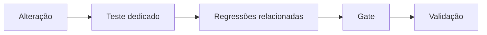

# Technical Evidence

Este documento reúne evidências técnicas selecionadas do desenvolvimento e da validação da plataforma.

O objetivo não é apresentar testes internos como certificação externa.

Cada evidência deve ser interpretada apenas dentro do escopo efetivamente testado.

---

## 1. Tipos de evidência

O projeto possui atualmente quatro categorias principais de evidência:

| Categoria | Situação |
|---|---|
| Uso operacional | Ambiente industrial real |
| Testes e regressões | Automatizados e executados durante a evolução |
| Arquitetura fiscal | Validada internamente |
| Homologação fiscal externa | Pendente |

Essa distinção é importante.

**Teste interno não substitui homologação externa.**

---

## 2. Uso operacional real

A camada de conferência é utilizada em ambiente industrial real.

Essa utilização inclui processamento continuado de mapas, itens e fluxos de
conferência em uma operação industrial. Volumes, valores, períodos e
identificadores não são publicados neste showcase para preservar a
confidencialidade operacional.

Evidências quantitativas podem ser apresentadas de forma controlada durante
due diligence, com a anonimização e as autorizações adequadas.

O uso operacional não representa automaticamente:

- receita do software;
- faturamento realizado pelo sistema;
- documentos fiscais emitidos pela plataforma.

A principal evidência aqui é a exposição da camada operacional a processos e volumes reais de utilização.

---

## 3. Estratégia de regressão

Mudanças estruturais são acompanhadas por testes.

O fluxo adotado pode ser resumido como:



O objetivo é reduzir o risco de uma refatoração alterar silenciosamente comportamentos existentes.

---

## 4. Evidência de refatoração fiscal

A Etapa 2 da refatoração fiscal, executada em fatias de 2A a 2N, separou do orquestrador de Pré-Faturamento responsabilidades relacionadas a:

- saída e artefatos;
- geração de XLSX;
- prontidão;
- mensagens;
- produtos;
- composição comercial;
- transporte;
- entrada e lotes;
- participantes;
- contexto canônico;
- pedidos;
- itens;
- composição tributária e totais;
- documentação, governança e relatório final.

Ao longo desse fechamento:

- responsabilidades foram transferidas para módulos especializados;
- contratos históricos foram preservados através de fachadas;
- autoridades existentes foram explicitamente injetadas nos módulos extraídos;
- os módulos extraídos não receberam dependência direta de Flask, `request`, `session` ou contexto web;
- o arquivo remanescente passou a atuar como fachada e orquestrador;
- as autoridades de domínio permaneceram nos serviços existentes;
- não houve reimplementação do motor tributário;
- nenhuma fórmula ou decisão fiscal foi alterada.

Entre o baseline da Etapa 0 e o fechamento da Etapa 2, o orquestrador principal passou de:

**2.808 linhas → 774 linhas**

Isso representa uma redução líquida de **2.034 linhas**, ou aproximadamente **72,4%**, considerando a mesma forma de contagem nos dois pontos.

O objetivo dessa métrica não é utilizar quantidade de linhas como medida de qualidade.

Ela serve apenas como evidência da retirada de responsabilidades do antigo orquestrador e deve ser lida em conjunto com a preservação dos contratos e os gates de regressão.

A **Etapa 3 — Matriz Canônica** permanece futura e não havia sido iniciada no checkpoint de fechamento da Etapa 2.

---

## 5. Gate documentado da refatoração

No fechamento completo da Etapa 2 foram registrados:

```text
PYTHON_COMPILE = PASS
TESTE_DEDICADO_2N = PASS
REGRESSÕES_DIRETAMENTE_AFETADAS = 6/6 PASS
GATE_RÁPIDO = 48/48 PASS
GATE_INTEGRAÇÃO = 143/143 PASS
GATE_RELEASE = 144/144 PASS
INTEGRITY_CHECK = ok
FOREIGN_KEY_CHECK = 0
```

Esses resultados correspondem ao escopo e ao estado do projeto no momento em que o fechamento foi registrado. Não representam certificação externa nem garantem cobertura de todos os cenários possíveis.

Também houve uma otimização da infraestrutura dos gates, sem remoção de testes, enfraquecimento de asserções, reclassificação de cobertura ou uso do banco empresarial como massa de teste.

Medições históricas registradas antes do fechamento 2N:

| Gate | Antes | Depois | Redução aproximada | Resultado no momento da medição |
|---|---:|---:|---:|---|
| Rápido | 216,5 s | 102,27 s | 52,8% | 35/35 PASS |
| Integração | 1.614,3 s | 1.024,18 s | 36,6% | 130/130 PASS |

Esses percentuais são **medições históricas naquele ambiente e naquele conjunto de testes**. Não constituem promessa permanente de desempenho. Os totais posteriores de 48/48, 143/143 e 144/144 refletem a evolução do conjunto de testes e não devem ser comparados diretamente com os totais usados nas medições de otimização.

Também foram documentados testes históricos fora de gates anteriores cujas expectativas já divergiam do comportamento então existente.

Essas expectativas não foram artificialmente modificadas apenas para produzir resultado verde.

---

## 6. POC de independência do núcleo fiscal

Em outubro de 2026 foi executada uma prova controlada com o objetivo de responder a uma pergunta específica:

> O caminho fiscal principal consegue ser executado por um processo Python independente da aplicação web?

A prova utilizou:

- processo Python isolado;
- banco temporário;
- migrations oficiais;
- fixture fiscal explícita;
- autoridades fiscais governadas;
- caminho real de Pré-Faturamento;
- Matriz Canônica;
- tratamentos;
- motor tributário;
- materialização;
- snapshot;
- contrato de emissão;
- formação local do payload do adapter.

---

## 7. Caminho executado pela POC


Resultado:

```text
POC_RESULTADO = PASS
EXTRAIBILIDADE_FINAL = MEDIA_COMPROVADA
```

---

## 8. Isolamento observado

Durante a POC:

```text
Servidor web iniciado = NÃO
Contexto Flask utilizado = NÃO
Rotas HTTP utilizadas = NÃO
Request/session utilizados = NÃO
Frontend utilizado = NÃO
Chamadas de rede = 0
NF-e transmitida = NÃO
```

O processo também não importou a aplicação web principal.

Isso fornece evidência de que o caminho fiscal testado não depende funcionalmente do servidor web para executar aquele cenário.

---

## 9. Banco isolado

A POC não utilizou o banco empresarial como massa de teste.

O fluxo utilizou banco temporário criado para a execução.

Foram registradas as seguintes verificações:

```text
integrity_check = ok
foreign_key_check = 0
```

O banco operacional principal permaneceu inalterado durante a janela controlada da prova.

---

## 10. Snapshot

A prova também verificou uma propriedade importante da arquitetura:

**imutabilidade do resultado fiscal aprovado.**

Depois da criação e aprovação do snapshot, alterações posteriores nos cadastros utilizados pela prova não modificaram o snapshot anteriormente aprovado.

Isso fornece evidência para a separação entre:

```text
estado atual dos cadastros
          ≠
estado fiscal aprovado da operação
```

---

## 11. Contrato de emissão

O contrato de emissão utilizado na POC foi originado do snapshot aprovado.

O objetivo dessa fronteira é impedir que a futura etapa de emissão reconstrua silenciosamente a decisão tributária utilizando cadastros que possam ter sido alterados depois da aprovação.

Fluxo:


---

## 12. Limite da POC

A classificação final foi:

**Extraibilidade média comprovada**

e não independência total.

A execução ainda possui dependências relacionadas a:

- configuração antecipada do caminho do banco;
- algumas conexões internas implícitas;
- autoridade fiscal persistida;
- orquestração de múltiplas funções;
- inexistência, naquele momento, de uma fachada headless única.

Esses fatores não impediram a execução independente do cenário, mas impedem classificar o núcleo como biblioteca autônoma completamente desacoplada.

---

## 13. Evidência de instalação e persistência

O projeto possui testes internos envolvendo:

- banco iniciado do zero;
- aplicação de migrations;
- integridade;
- instalação virgem;
- backup e restauração;
- evolução de schema.

Também existem gates de integração e release utilizados durante o desenvolvimento.

Os números desses gates evoluem juntamente com o projeto e, por isso, esta página evita tratar um único total histórico como quantidade definitiva de testes da plataforma.

---

## 14. Resiliência interna da camada NF-e

A arquitetura interna relacionada ao ciclo de emissão possui testes para comportamentos como:

- sequenciamento;
- persistência de estados;
- idempotência interna;
- tratamento de resposta incerta;
- pós-autorização;
- eventos;
- cancelamento;
- CC-e;
- segurança web.

Essas validações representam **comportamento interno da aplicação**.

Elas não substituem testes contra infraestrutura fiscal externa.

---

## 15. O que NÃO foi comprovado

As evidências internas apresentadas neste documento não comprovam:

```text
Assinatura digital real completa          NÃO COMPROVADA AQUI
Transmissão real de NF-e                  NÃO
Autorização SEFAZ real                    NÃO
Homologação externa completa              NÃO
Cobertura tributária nacional completa    NÃO
Todos os cenários fiscais possíveis       NÃO
Escalabilidade ilimitada                  NÃO
Biblioteca fiscal totalmente autônoma     NÃO
```

Nenhuma NF-e real foi transmitida durante a POC de independência.

---

## 16. Próxima fronteira de validação

No roadmap técnico interno, a **Etapa 3 — Matriz Canônica** é futura. Ela deverá ser tratada como uma nova etapa de auditoria e modularização, separada do fechamento 2A–2N e sujeita à sua própria validação.

Independentemente desse roadmap interno, a principal fronteira que separa validação interna de validação fiscal externa é a homologação controlada.

Essa etapa externa deverá utilizar infraestrutura e credenciais válidas e comprovar o comportamento do sistema contra serviços fiscais externos.

Somente depois dessa etapa evidências internas e externas poderão ser apresentadas conjuntamente.

---

## 17. Princípio de evidência

O projeto segue uma regra simples:

> **Não apresentar como comprovado aquilo que o teste executado não demonstrou.**

Por isso são mantidas separações explícitas entre:

**implementado**

**testado internamente**

**utilizado operacionalmente**

**comprovado por POC**

e

**homologado externamente**

---

## 18. Due diligence

Evidências técnicas adicionais podem ser disponibilizadas em processo controlado de avaliação, incluindo, quando apropriado:

- relatórios de testes;
- histórico de migrations;
- relatórios de regressão;
- documentação de arquitetura;
- artefatos da POC;
- hashes de integridade;
- histórico de evolução;
- demonstrações controladas;
- acesso supervisionado ao código-fonte.

O repositório público apresenta apenas uma visão sanitizada dessas evidências.

Dados empresariais, credenciais, certificados e código-fonte proprietário não fazem parte deste showcase público.
